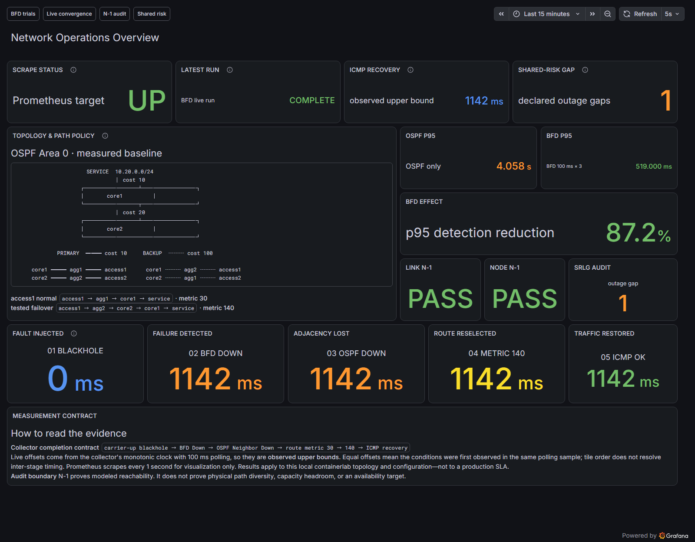
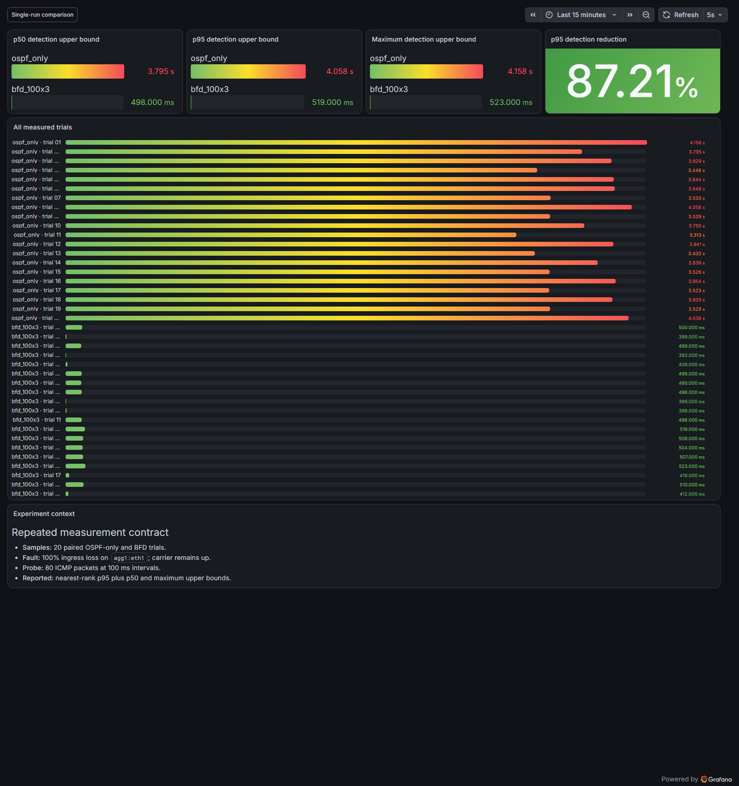

# TelcoNet Sentinel 분석 결과 보고서

## 1. 보고서 목적

이 문서는 TelcoNet Sentinel에서 수행한 장애 복구 실험과 설계 감사를 사람이 읽기 쉬운 형태로 해석한 보고서다. 수치 자체와 입력 파일의 무결성은 [자동 생성 실험 보고서](EXPERIMENT_REPORT.md)가 담당하고, 여기서는 그 결과가 네트워크 설계와 운영 관점에서 무엇을 의미하는지 설명한다.

분석 대상은 다음 세 가지다.

1. OSPF cost 정책이 정상 경로와 장애 우회 경로를 의도대로 선택하는가
2. carrier-up 원격 블랙홀에서 BFD가 OSPF dead timer보다 장애를 빠르게 탐지하는가
3. 링크·노드 N-1을 통과한 설계가 공유위험 장애에서도 서비스를 유지하는가

## 2. 결론

| 질문 | 결론 | 근거 |
|---|---|---|
| 경로 정책이 결정적으로 동작했는가 | 정상 cost `30`, 우회 cost `140`으로 모든 비교 실험에서 같은 전환을 확인했다 | 단회 OSPF/BFD 원시 로그와 경로·metric 기록 |
| BFD가 장애 탐지를 개선했는가 | BFD의 p95 탐지 관측 상한은 `519ms`로 OSPF-only의 `4,058ms`보다 87.21% 낮았다 | 프로필별 20회, 총 40회 반복 실험 |
| 탐지 개선이 패킷 손실 감소로 이어졌는가 | 전환 전 손실 p95가 `37`개에서 `3`개로 줄었다 | 동일한 100ms ICMP probe 조건 |
| N-1 통과가 완전한 이중화를 뜻하는가 | 아니다. 서비스 이중화 후보도 `service-entry` 공유 관로 장애에서는 두 Access가 모두 단절됐다 | 선언된 failure domain의 결정론적 그래프 분석 |

가장 중요한 결과는 단순히 “BFD가 빠르다”가 아니다. 경로 정책, 장애 탐지, RIB 변경, 데이터 플레인 복구, 공유위험을 한 흐름에서 확인해야 복원력을 설명할 수 있다는 점이다.



## 3. 실험 조건

### 3.1 네트워크

- FRRouting 10.7.0 라우터 6대
- containerlab 기반 Access–Aggregation–Core 토폴로지
- 모든 라우터는 OSPF Area 0 사용
- transit link는 `/31` point-to-point
- primary cost `10`, backup cost `100`, inter-core cost `20`
- access1 정상 서비스 경로 cost `30`, 우회 경로 cost `140`

### 3.2 장애 주입

`agg1:eth1`의 carrier 상태는 유지하고 ingress 패킷만 100% 차단했다. 따라서 물리 인터페이스 Down 이벤트가 아니라 OSPF hello/dead timer 또는 BFD 세션 상태로 원격 장애를 찾아야 한다.

| 프로필 | 탐지 설정 |
|---|---|
| OSPF only | hello 1초, dead 4초 |
| BFD | minimum TX/RX 100ms, multiplier 3 |

두 프로필 모두 100ms 간격 ICMP probe와 같은 경로 완료 조건을 사용했다. 실험은 프로필별 20회씩 하나의 로컬 containerlab 배포에서 순차 실행했다.

### 3.3 판정 조건

장애 주입 이후 다음 상태를 분리해서 확인했다.

```text
blackhole_injected
  → bfd_down
  → ospf_neighbor_down
  → route_failover (metric 30 → 140)
  → data_plane_recovered
```

OSPF neighbor Down만으로 서비스 복구를 판정하지 않았다. RIB가 backup metric `140`으로 바뀌고 ICMP 응답이 다시 관측돼야 데이터 플레인 복구가 완료된 것으로 처리했다.

## 4. OSPF/BFD 비교 분석

### 4.1 반복 실험 결과

| 지표 | OSPF only | BFD 100ms × 3 | 차이 |
|---|---:|---:|---:|
| 탐지 상한 최소 | 3,313ms | 393ms | BFD 최대값보다도 OSPF 최소값이 큼 |
| 탐지 상한 p50 | 3,794.5ms | 498ms | 86.88% 감소 |
| 탐지 상한 p95 | 4,058ms | 519ms | 87.21% 감소 |
| 탐지 상한 최대 | 4,158ms | 523ms | 두 표본 분포가 겹치지 않음 |
| 전환 전 손실 p95 | 37 packets | 3 packets | 34 packets 감소 |



20회 표본에서는 BFD의 가장 느린 탐지 관측값 `523ms`도 OSPF-only의 가장 빠른 값 `3,313ms`보다 작았다. 즉, 이 랩 조건에서는 일부 빠른 OSPF 표본 때문에 두 결과가 겹치는 현상이 나타나지 않았다.

BFD의 설정상 탐지 기준은 약 300ms지만 실제 관측 상한은 393~523ms였다. 이 차이에는 BFD 자체 처리뿐 아니라 100ms polling 간격, FRR 상태 반영, 명령 실행과 관측 시점의 오차가 포함된다. 따라서 `519ms`를 BFD 프로토콜 내부 처리시간으로 해석하면 안 된다.

OSPF-only는 4초 dead timer를 사용했고 관측값은 3,313~4,158ms였다. 장애 발생 시점과 hello/dead timer 주기의 상대적 위치 때문에 표본 사이에 차이가 생길 수 있으며, 결과는 해당 설정에서 기대되는 범위와 일치했다.

### 4.2 단회 경로 전환

| 프로필 | 탐지 관측 상한 | 전환 전 손실 | 경로 metric |
|---|---:|---:|---:|
| OSPF only | 3,384ms | 31 packets | `30 → 140` |
| BFD 100ms × 3 | 336ms | 2 packets | `30 → 140` |

두 프로필이 같은 backup 경로로 전환했기 때문에 차이를 경로 정책이 아니라 장애 탐지 방식의 차이로 제한할 수 있었다. BFD는 OSPF cost를 바꾸지 않고 neighbor failure 전달 시점만 앞당겼다.

## 5. 복원력 설계 분석

### 5.1 링크·노드 N-1

초기 설계에는 `core1--service-host` 단일 장애점이 있었다. `core2--service-host`를 추가한 서비스 이중화 후보는 다음 조건을 통과했다.

- 11개 단일 링크 장애에서 서비스 경로 유지
- `agg1`, `agg2`, `core1`, `core2`를 각각 제거해도 서비스 경로 유지

이 결과는 논리 토폴로지에서 단일 링크 또는 단일 전송 노드 장애를 우회할 수 있다는 뜻이다. 용량 여유, 물리 관로 분리, 전원 분리까지 증명하는 결과는 아니다.

### 5.2 공유위험

| Failure domain | 동시에 제거한 자원 | 결과 | 해석 |
|---|---|---|---|
| `primary-site-power` | `agg1`, `core1` | `DEGRADED` | access1은 cost `30 → 140`으로 우회, access2는 cost `50` 유지 |
| `service-entry` | 두 service-facing link | `OUTAGE` | access1·access2 모두 service prefix에 도달 불가 |

`service-entry` 결과는 장비와 논리 링크가 이중화돼도 두 회선이 같은 인입 관로를 공유하면 하나의 사고로 함께 단절될 수 있음을 보여준다. 따라서 다음 설계 단계에서는 두 service-facing link의 물리 인입 경로와 전원·시설 failure domain을 분리해야 한다.

## 6. 운영 관점의 해석

### 탐지와 복구를 분리해야 한다

BFD Down은 장애를 빠르게 발견했다는 뜻이지 서비스가 복구됐다는 뜻은 아니다. OSPF adjacency, RIB metric, ICMP 응답을 별도 단계로 기록해야 탐지 지연과 경로 설치 지연을 구분할 수 있다.

### 하나의 숫자보다 분포가 중요하다

단회 실험에서는 BFD `336ms`, OSPF `3,384ms`가 관측됐지만 반복 실험의 p95는 각각 `519ms`, `4,058ms`였다. 포트폴리오와 운영 판단에는 가장 좋은 한 번의 결과보다 반복 표본의 분포와 최악값이 더 유용하다.

### N-1과 SRLG는 다른 질문이다

N-1은 한 번에 하나의 구성요소가 사라지는 상황을 확인한다. SRLG 분석은 서로 다른 장비나 링크가 실제로는 같은 전원, 관로, 시설을 공유하는 상황을 다룬다. 두 검증을 함께 사용해야 논리적 이중화와 공통 원인 장애를 구분할 수 있다.

## 7. 근거와 재현성

| 근거 | 역할 |
|---|---|
| [단회 비교 evidence](../evidence/bfd-comparison.json) | 경로, metric, 탐지 상한, packet loss |
| [반복 실험 evidence](../evidence/bfd-repeated-trials.json) | 40회 표본과 p50·p95·최대값 |
| [SRLG audit evidence](../evidence/failure-domain-audit.json) | failure domain별 도달성과 비용 변화 |
| [자동 생성 실험 보고서](EXPERIMENT_REPORT.md) | 입력 digest와 configuration/topology fingerprint |
| [OSPF 설계 문서](OSPF_DESIGN.md) | 주소·cost·passive interface 설계 |

보고서 생성기는 단회 2개와 반복 40개 원시 로그를 다시 파싱하고, 현재 lab 설정 fingerprint와 비교한다. SRLG 결과도 versioned intent와 failure-domain 선언에서 다시 계산한다. 원시 자료와 파생 evidence가 다르면 보고서 생성을 중단한다.

```bash
telconet-report --output docs/EXPERIMENT_REPORT.md
pytest -q --cov=telconet_sentinel --cov-branch --cov-fail-under=80
```

## 8. 해석 범위

- 결과는 로컬 containerlab, FRR 10.7.0, 현재 CPU 부하와 polling 방식에 한정된다.
- 측정값은 이벤트 사이의 실제 내부 처리시간이 아니라 수집기가 상태를 처음 확인한 관측 상한이다.
- 반복 실험은 하나의 배포에서 순차 실행했으며 실행 순서를 무작위화하거나 여러 호스트에서 반복하지 않았다.
- SRLG 결과는 선언된 failure domain에 대한 모델 분석이며 실제 관로·전원 분리를 현장에서 확인한 결과가 아니다.
- 본 실험은 capacity headroom, 장기 부하, 인증, vendor interoperability, 무손실 전환을 검증하지 않았다.
- 따라서 이 수치를 실서비스 SLA나 일반적인 OSPF/BFD 성능으로 확대 해석할 수 없다.

## 9. 다음 검증 과제

1. 반복 실험의 프로필 순서를 무작위화하고 독립 배포에서 재실행
2. CPU·메모리 부하를 추가한 상태에서 탐지와 데이터 플레인 복구 분포 비교
3. ECMP와 다중 장애 조건에서 packet reordering·loss burst 측정
4. 선언된 SRLG를 실제 물리 토폴로지 자료와 대조하는 검증 절차 설계
5. Alertmanager 연동 후 탐지부터 알림 수신까지의 운영 지연 측정
