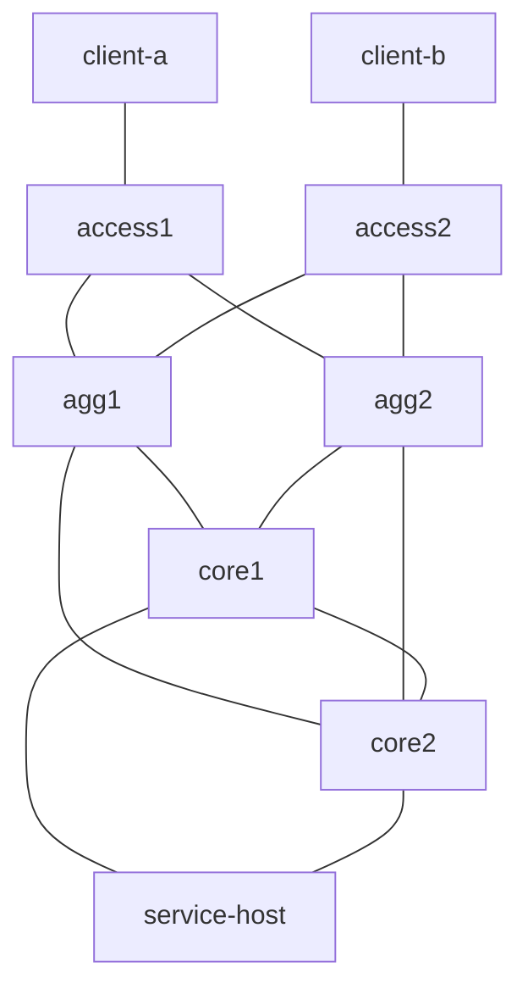

# Architecture

## Design goal

TelcoNet Sentinel separates the network lab, analysis logic, and recovery execution boundary. The API analyzes an event and creates a typed recovery proposal, but it does not receive or execute arbitrary shell commands.

```mermaid
flowchart LR
    CLAB["containerlab · FRR routers"] --> EVENT["link event"]
    EVENT --> API["FastAPI incident service"]
    CLAB --> SNAPSHOT["FRR runtime snapshot"]
    INTENT --> PREFLIGHT["intent-runtime conformance"]
    SNAPSHOT --> PREFLIGHT
    PREFLIGHT -->|PASS| EVENT
    CLAB --> COLLECTOR["host live collector · 100ms poll"]
    COLLECTOR -->|"typed convergence events"| API
    API --> STORE[("SQLite · bounded recent runs")]
    CATALOG["designs.yml"] --> INTENT["versioned intent YAML"]
    INTENT --> SCHEMA["strict Pydantic schema"]
    SCHEMA --> GRAPH["validated topology graph"]
    GRAPH --> IMPACT["cost-aware impact analysis"]
    GRAPH --> FACTORY["typed fault scenario factories"]
    DOMAINS["failure-domains.yml"] --> FACTORY
    FACTORY --> N1["common fault audit engine"]
    N1 --> PLAN["typed runtime N-1 plan"]
    PLAN --> MATRIX["FRR link · node fault matrix"]
    CLAB --> MATRIX
    MATRIX --> RAW
    N1 --> API
    API --> IMPACT
    IMPACT --> INCIDENT["incident + impact + evidence"]
    INCIDENT --> APPROVAL["typed state transition"]
    APPROVAL --> RUNBOOK["local allowlisted runbook"]
    RUNBOOK --> CLAB
    CLAB --> RAW["timestamped experiment logs"]
    RAW --> EVIDENCE["recalculated JSON evidence"]
    EVIDENCE --> MANIFEST["64-artifact evidence manifest"]
    MANIFEST --> ATTEST["CI archive provenance attestation"]
    ATTEST --> SUMMARY["attested N-1 dashboard summary"]
    SUMMARY --> METRICS
    EVIDENCE --> METRICS["FastAPI /metrics"]
    METRICS --> PROM["Prometheus scrape · 1s"]
    PROM --> RULES["simulation alert rules · 20s hold"]
    PROM --> GRAFANA["Grafana provisioned dashboard"]
```

## Analysis boundaries

The analysis path has seven explicit layers:

1. `intent.py` rejects malformed or ambiguous YAML before domain objects exist.
2. `Topology` owns graph identity and weighted path calculation, including sets of excluded links and nodes.
3. `fault.py` declares immutable link, node, and composite fault scenarios.
4. `audit.py` owns the single reachability and cost-comparison algorithm. `resilience.py` only adapts its results to the established link/node API and metric contracts.
5. `failure_domain.py` validates declared shared-risk groups and adapts their composite faults, access-path costs, API output, and bounded-label metrics.
6. `runtime_conformance.py` compares a pre-fault FRR snapshot with versioned intent and experiment expectations. A failed check prevents the live fault experiment from starting.
7. `runtime_resilience.py` maps every modeled candidate link and transport node to bounded, typed containerlab interfaces. The runner compares fault and restoration route metrics and reachability, and requires the complete OSPF adjacency baseline before starting the next scenario.

`lab/designs.yml` declares which intent is the historical baseline and which is a candidate. This sidecar keeps the relationship explicit without changing `lab/intent.yml`, whose bytes are part of the checked-in 40-trial evidence fingerprint.

## Trust boundaries

- The API accepts `event_type`, `link_id`, and an optional timestamp.
- Only topology link identifiers are valid recovery targets.
- Only `restore_link` is allowed in Phase 1.
- The Phase 1 approval endpoint has no operator identity; it changes local typed state only.
- The local runbook owns privileged lab commands and is not invoked by the API.
- The host collector owns `docker exec`, reads FRR JSON and continuous ICMP, and sends only typed event fields to the API.
- The E2E runner captures OSPF neighbor, RIB/FIB route, and BFD JSON before fault injection. The conformance process reads only bounded local files and emits per-check expected/actual evidence.
- Runtime conformance is a fail-closed precondition for the live experiment; it does not modify router state.
- The runtime N-1 runner is the privileged mutation boundary for the candidate lab. Its node and interface values come only from the validated plan, are checked again by the shell, and are passed as quoted arguments to `docker exec`.
- Runtime N-1 observations must contain the exact planned scenario and access-node sets. Missing, duplicated, or extra observations fail closed.
- The checked-in runtime N-1 dashboard summary is a provenance index for an attested main run, not a replacement for its raw archive. API startup requires its topology fingerprint, exact link/node fault matrix, and eight checks per scenario to match the current candidate intent.
- The checked-in evidence manifest binds every report input and output after semantic recalculation; bounded reads and an exact inventory prevent unreviewed files from entering the bundle.
- The E2E job has read-only repository permissions. A separate main-only job receives OIDC and attestation permissions after downloading the completed, size-bounded regular-file archive.
- CI preloads FRR and Alpine by immutable multi-platform digest before containerlab resolves the historical topology image tags.
- The API container does not mount the Docker socket.
- Live event offsets use a monotonic clock and represent polling-based observation upper bounds.
- The API writes only validated typed convergence fields to a local SQLite volume; no SQL or file path is accepted from an API request.
- Alert rules are local simulation guardrails, not production SLOs, and no Alertmanager receiver is configured.

## Topology

All router links participate in OSPF area 0. Interface costs create explicit primary and backup paths. The customer-facing `/24` networks are advertised from passive access interfaces.

## Phase boundaries

- Phase 1: OSPF cost-aware impact analysis, typed recovery state, scenario evidence.
- Phase 2: completed BFD remote-failure comparison and Prometheus-compatible evidence metrics.
- Phase 3: completed live BFD/OSPF/RIB/ICMP convergence timeline and containerlab E2E CI.
- Phase 4a: completed bounded SQLite event persistence and promtool-tested local alert evaluation.
- Phase 4b: Alertmanager delivery, BGP/MPLS L3VPN, distributed event storage, and streaming telemetry.
- Phase 5a: completed deterministic N-1 single-link audit and Grafana scenario matrix.
- Phase 5b: completed service dual-homing design and transport-node failure audit.
- Phase 5c: completed strict shared-risk failure-domain modeling, cost-aware composite audit, API, metrics, and Grafana matrix.
- Phase 6a: completed fail-closed intent-runtime preflight for the live convergence experiment.
- Phase 6b: completed model-to-runtime N-1 matrix for 11 links and four transport nodes, with 120 route and reachability checks.
- Foundation 1: completed strict versioned intent/catalog validation and a common multi-component fault audit engine.
