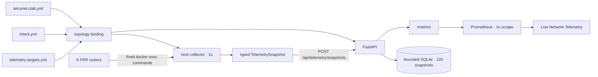

# 운영 텔레메트리

## 목적

장애 실험이 끝난 뒤에도 현재 랩이 어떤 상태인지 바로 확인할 수 있어야 한다. 이를 위해 baseline FRR 라우터 6대에서 인터페이스, OSPF 인접 관계, BFD peer, `10.20.0.0/24` 서비스 경로를 수집하고 Grafana에 표시한다.

이 경로는 **운영 가시성**을 위한 것이다. 1초 polling과 Prometheus scrape 결과로 sub-second 수렴 시간을 계산하지 않는다. 장애 탐지와 서비스 복구 시간은 별도의 convergence collector가 100ms 간격으로 남긴 원본 이벤트 timestamp를 근거로 삼는다.

## 데이터 흐름



API 컨테이너는 containerlab과 직접 통신하지 않는다. Docker를 사용할 수 있는 호스트에서 수집기를 실행하고, API에는 검증된 JSON snapshot만 보낸다.

## 무엇을 수집하나

수집 대상은 [telemetry-targets.yml](../lab/telemetry-targets.yml)에 고정된 `access1`, `access2`, `agg1`, `agg2`, `core1`, `core2`다. 설정의 기본 주기는 1초이며 서비스 prefix는 `10.20.0.0/24`다.

| 항목 | FRR·Linux 조회 | snapshot 필드 |
|---|---|---|
| 인터페이스 | `ip -s -j link show` | oper state, RX/TX bytes, RX/TX drops |
| OSPF | `show ip ospf neighbor json` | neighbor, interface, Full 여부 |
| BFD | `show bfd peers json` | peer, interface, configured 여부, Up 여부 |
| 서비스 경로 | `show ip route 10.20.0.0/24 json` | route 존재, metric, 선택된 egress interface |

수집 명령은 코드에 고정되어 있다. CLI나 API 요청으로 임의 명령을 추가할 수 없다. 라우터 하나의 조회가 실패하면 그 라우터를 `collection_success=0`, state `unknown`으로 기록하며 일부 값만 정상인 것처럼 게시하지 않는다. FRR이 반환한 peer IP를 metric label로 그대로 사용하지 않고, interface와 topology binding을 대조해 상대 node 이름으로 정규화한다. 선언된 OSPF peer가 응답에서 사라지면 `down`, BFD peer가 없으면 `configured=false`, state `unknown`으로 명시한다.

## 설정과 snapshot 검증

수집기와 API는 시작할 때 세 파일을 함께 읽는다.

- `lab/telemetry-targets.yml`: 허용된 6대의 node·container 이름, 주기, 서비스 prefix
- `lab/intent.yml`: node role, 링크 ID, 서비스 prefix 소유자
- `lab/telconet.clab.yml`: 실제 container 이름과 node별 interface 연결

이 세 입력의 SHA-256으로 topology fingerprint를 만든다. 수집기는 fingerprint를 snapshot에 넣고, API는 서버에서 계산한 값과 일치할 때만 저장한다. 다음 조건도 함께 검사한다.

- 정확히 baseline 라우터 6대가 한 번씩 들어 있는가
- node와 container 이름이 baseline containerlab naming과 일치하는가
- interface가 현재 topology binding에 선언되어 있는가
- OSPF·BFD peer가 topology에 선언된 상대 node·interface 집합과 정확히 일치하는가
- route가 allowlist에 있는 서비스 prefix 하나만 가리키는가
- 알 수 없는 JSON 필드나 중복 interface·neighbor·peer·route가 없는가
- 새 snapshot의 시간이 현재 저장값보다 뒤인가
- 수집 시각이 API 시계보다 60초 넘게 미래가 아닌가

같은 ID와 같은 payload를 다시 보내는 것은 안전한 retry로 처리한다. 같은 ID의 내용이 달라지거나 과거 snapshot이 도착하면 `409`로 거부한다. 설정이 바뀐 뒤에는 현재 fingerprint와 일치하는 snapshot만 조회·metric 변환 대상으로 사용하므로, SQLite에 남은 이전 topology 상태가 새 화면에 섞이지 않는다.

## API와 저장

| 경로 | 역할 |
|---|---|
| `POST /api/telemetry/snapshots` | typed snapshot 검증 및 저장 |
| `GET /api/telemetry/snapshots/latest` | 가장 최근 snapshot 조회 |
| `GET /metrics` | 최근 snapshot을 Prometheus 형식으로 노출 |

Docker Compose에서는 `/var/lib/telconet/telemetry.sqlite3`에 최근 snapshot 120개만 보관한다. 이 DB는 collector 장애 뒤 마지막 상태를 확인하고 API를 재시작해도 최근 snapshot을 유지하기 위한 작은 운영 저장소다. 장기 분석용 시계열 DB는 아니다.

## Prometheus metric

상태 metric은 `up=1`, `down=0`, `unknown=-1`로 구분한다. 값이 없거나 수집에 실패한 상태를 정상 `0/1`로 바꾸지 않는다. Dashboard에서는 snapshot age를 먼저 확인해야 한다.

| 범주 | metric |
|---|---|
| freshness | `telconet_telemetry_snapshot_timestamp_seconds` |
| router | `telconet_router_collection_success`, `telconet_topology_node_info` |
| interface | `telconet_interface_oper_up`, `telconet_interface_receive_bytes_total`, `telconet_interface_transmit_bytes_total`, `telconet_interface_receive_drops_total`, `telconet_interface_transmit_drops_total` |
| topology | `telconet_topology_link_oper_up` |
| OSPF | `telconet_ospf_neighbor_full` |
| BFD | `telconet_bfd_peer_configured`, `telconet_bfd_peer_up` |
| route | `telconet_selected_route_present`, `telconet_selected_route_metric`, `telconet_selected_route_egress` |

`node`, `interface`, `neighbor`, `peer`, `prefix`, `link_id`, `role` label은 검증된 topology와 수집 대상 안에서만 만들어진다. 자유 입력 문자열을 metric label로 내보내지 않는다.

## Dashboard

Docker Compose가 dashboard와 datasource를 자동 provisioning한다. 별도 Grafana plugin은 필요하지 않다.

```text
http://127.0.0.1:3000/d/telconet-live-telemetry
```

화면에는 다음 정보를 배치했다.

- 마지막 snapshot age와 수집에 성공한 router 수
- OSPF·BFD 전체 상태와 access별 선택 route metric
- node role과 link state를 결합한 live topology
- router별 서비스 경로와 egress link
- interface oper state, OSPF neighbor, BFD peer 표
- RX/TX throughput과 drop counter rate
- 1초 telemetry와 100ms convergence evidence를 구분하는 측정 계약

## 실행

### 1. API·Prometheus·Grafana

저장소 루트에서 스택을 올린다.

```bash
docker compose up -d --build
```

### 2. Baseline containerlab

containerlab은 Linux network namespace를 사용한다. Linux 또는 WSL2에서 별도로 배포한다.

```bash
sudo containerlab deploy --topo lab/telconet.clab.yml
```

### 3. 연속 수집

Docker와 containerlab에 접근할 수 있는 호스트에서 실행한다. 기본 설정은 1초 간격이며 프로세스는 `Ctrl+C`로 종료한다.

```bash
uv run telconet-telemetry --config lab/telemetry-targets.yml --api-url http://127.0.0.1:18000
```

### 4. 한 번만 확인

API 연결과 dashboard 표시만 빠르게 확인하려면 one-shot wrapper를 사용한다.

```bash
bash scenarios/telemetry_demo.sh
```

정리할 때는 containerlab과 dashboard 스택을 각각 내린다.

```bash
sudo containerlab destroy --topo lab/telconet.clab.yml --cleanup
docker compose down
```

## 신뢰 경계

- Docker 명령 실행 권한은 호스트 collector에만 있다.
- API와 Grafana 컨테이너에는 Docker socket을 mount하지 않는다.
- API는 strict Pydantic model과 서버가 가진 topology binding으로 snapshot을 다시 검증한다.
- API container는 read-only filesystem과 `no-new-privileges`로 실행한다. SQLite만 named volume에 쓴다.
- Dashboard는 Prometheus metric만 읽으며 네트워크 상태를 변경하지 않는다.

## 검증

관련 계약은 다음 테스트에서 확인한다.

| 테스트 | 확인 내용 |
|---|---|
| `tests/unit/test_telemetry_models.py` | strict snapshot schema와 상태 의미 |
| `tests/unit/test_telemetry_config.py` | 6-router binding, interface mapping, fingerprint drift |
| `tests/unit/test_telemetry_collector.py` | JSON parser, 고정 명령, 실패 격리, one-shot·CLI 제한 |
| `tests/unit/test_telemetry_store.py` | retry, 순서, 120개 제한, SQLite 재시작 보존 |
| `tests/unit/test_telemetry_metrics.py` | bounded label과 `unknown=-1` 변환 |
| `tests/api/test_telemetry_api.py` | ingest, 최신 조회, drift·과거 snapshot 거부 |
| `tests/contract/test_live_telemetry_dashboard.py` | dashboard UID, panel, query, plugin 비의존성 |
| `tests/contract/test_telemetry_runtime.py` | image·Compose 설정, Docker socket 비노출, one-shot wrapper |

```bash
uv run pytest -q tests/unit/test_telemetry_models.py tests/unit/test_telemetry_config.py tests/unit/test_telemetry_collector.py tests/unit/test_telemetry_store.py tests/unit/test_telemetry_metrics.py tests/api/test_telemetry_api.py tests/contract/test_live_telemetry_dashboard.py tests/contract/test_telemetry_runtime.py
```

## 범위와 한계

- 여섯 router를 `docker exec`로 순차 조회하므로 모든 값이 정확히 같은 시점의 원자적 snapshot은 아니다.
- 1초는 목표 polling 주기다. 여섯 router 수집에 1초보다 오래 걸리면 다음 cycle은 즉시 시작하며 실제 간격은 늘어날 수 있다.
- OSPF·BFD·interface와 단일 서비스 prefix만 수집한다. BGP, MPLS, queue, CPU·memory telemetry는 포함하지 않는다.
- gNMI·SNMP streaming collector와 외부 NMS 연동은 구현하지 않았다.
- SQLite는 최근 120개 snapshot, 로컬 Prometheus는 1일만 보관한다.
- 이 dashboard는 로컬 containerlab의 운영 관측 화면이며 실서비스 NOC, SLA, 장비 telemetry 정확도를 검증한 결과가 아니다.
